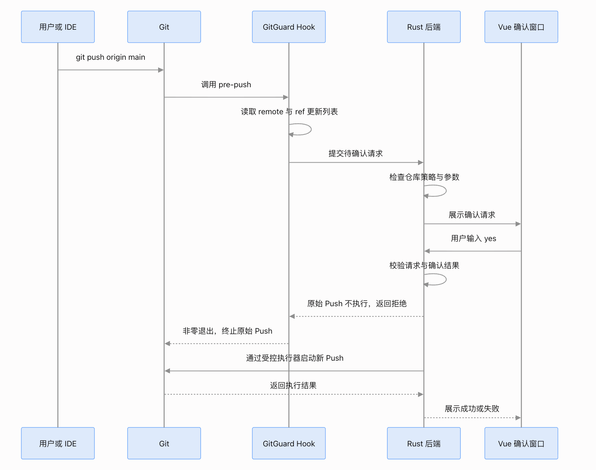

GitGuard：Git Push 二次确认技术设计
Git Push Guard
跨平台桌面端 · 安全拦截 · 本地配置

MVP

支持平台

Windows / macOS / Linux

前端

Vue 3 + TypeScript

确认机制

信息预览 + 输入 yes

配置存储

本地持久化，无云端依赖

1. 需求与安全边界
   1.1 核心用户流程
   用户执行 git push

GitGuard 拦截 Push

检查仓库策略，解析目标 Remote 与 Ref

打开确认界面

展示本地分支、目标分支、Commit 列表及差异摘要

用户检查信息并输入 yes

确认通过

重新验证目标并执行 Push

取消 / 超时

不执行本次 Push

1.2 必须遵守的安全规则

1. 默认启用确认保护：首次安装时开启 Push 确认；用户可以在界面中主动关闭。
2. 按仓库配置：每个 Git 仓库独立设置是否拦截，不影响其他仓库。
3. 确认后才推送：输入 yes 之前不得启动真正的 Push 操作。
4. 确认对象必须明确：展示提交的本地分支、目标 Remote、目标分支以及将要推送的 Commit。
5. 确认后重新验证：真正推送前重新检查当前仓库状态及目标参数，防止确认期间发生变化。
6. 默认拒绝不明确的操作：仓库无法识别、目标不明确、界面连接失败或校验失败时，不得静默执行受保护的 Push。
7. 关闭开关才允许直推：用户关闭保护后，后续 Push 不再弹出确认界面，但需要明确告知其安全影响。
8. 所有敏感数据仅在本地处理：不上传仓库内容、Commit 信息或账户配置。
9. 技术架构
   推荐采用 Vue 3 + Tauri 2 + Rust。Vue 负责界面与配置交互，Rust 负责 Git 拦截、进程管理、安全校验和跨平台系统集成。

选择 Tauri 的原因是可以复用 Vue 生态，同时使用 Rust 实现操作系统层的拦截逻辑，避免把 Git 安全控制仅放在前端。
拦截层：Git 原生 pre-push Hook

Git 原生 Hook 能在数据发送前检查本次推送涉及的引用，并通过非零退出码阻止推送。它是本方案的主要拦截点。

githooks Documentation
+1

桌面层：Tauri 2 + Rust

Rust 守护进程处理 Hook 请求、与桌面窗口通信，并负责真正的 Git 子进程执行；Vue 不能成为唯一的安全控制层。

存储层：SQLite 或本地 JSON

保存全局设置、仓库级开关、Hook 安装状态和必要的本地操作记录。不保存密码、令牌或 SSH 私钥。

2.1 架构图
#chatgpt-mermaid-_r_2e1_{font-family:-apple-system-body,ui-sans-serif,-apple-system,system-ui,"Segoe UI",Helvetica,"Apple Color Emoji",Arial,sans-serif,"Segoe UI Emoji","Segoe UI Symbol";font-size:16px;fill:rgb(13, 13, 13);}@keyframes edge-animation-frame{from{stroke-dashoffset:0;}}@keyframes dash{to{stroke-dashoffset:0;}}#chatgpt-mermaid-_r_2e1_ .edge-animation-slow{stroke-dasharray:9,5!important;stroke-dashoffset:900;animation:dash 50s linear infinite;stroke-linecap:round;}#chatgpt-mermaid-_r_2e1_ .edge-animation-fast{stroke-dasharray:9,5!important;stroke-dashoffset:900;animation:dash 20s linear infinite;stroke-linecap:round;}#chatgpt-mermaid-_r_2e1_ .error-icon{fill:rgb(243, 243, 243);}#chatgpt-mermaid-_r_2e1_ .error-text{fill:rgb(13, 13, 13);stroke:rgb(13, 13, 13);}#chatgpt-mermaid-_r_2e1_ .edge-thickness-normal{stroke-width:1px;}#chatgpt-mermaid-_r_2e1_ .edge-thickness-thick{stroke-width:3.5px;}#chatgpt-mermaid-_r_2e1_ .edge-pattern-solid{stroke-dasharray:0;}#chatgpt-mermaid-_r_2e1_ .edge-thickness-invisible{stroke-width:0;fill:none;}#chatgpt-mermaid-_r_2e1_ .edge-pattern-dashed{stroke-dasharray:3;}#chatgpt-mermaid-_r_2e1_ .edge-pattern-dotted{stroke-dasharray:2;}#chatgpt-mermaid-_r_2e1_ .marker{fill:rgb(143, 143, 143);stroke:rgb(143, 143, 143);}#chatgpt-mermaid-_r_2e1_ .marker.cross{stroke:rgb(143, 143, 143);}#chatgpt-mermaid-_r_2e1_ svg{font-family:-apple-system-body,ui-sans-serif,-apple-system,system-ui,"Segoe UI",Helvetica,"Apple Color Emoji",Arial,sans-serif,"Segoe UI Emoji","Segoe UI Symbol";font-size:16px;}#chatgpt-mermaid-_r_2e1_ p{margin:0;}#chatgpt-mermaid-_r_2e1_ .label{font-family:-apple-system-body,ui-sans-serif,-apple-system,system-ui,"Segoe UI",Helvetica,"Apple Color Emoji",Arial,sans-serif,"Segoe UI Emoji","Segoe UI Symbol";color:rgb(13, 13, 13);}#chatgpt-mermaid-_r_2e1_ .cluster-label text{fill:rgb(13, 13, 13);}#chatgpt-mermaid-_r_2e1_ .cluster-label span{color:rgb(13, 13, 13);}#chatgpt-mermaid-_r_2e1_ .cluster-label span p{background-color:transparent;}#chatgpt-mermaid-_r_2e1_ .label text,#chatgpt-mermaid-_r_2e1_ span{fill:rgb(13, 13, 13);color:rgb(13, 13, 13);}#chatgpt-mermaid-_r_2e1_ .node rect,#chatgpt-mermaid-_r_2e1_ .node circle,#chatgpt-mermaid-_r_2e1_ .node ellipse,#chatgpt-mermaid-_r_2e1_ .node polygon,#chatgpt-mermaid-_r_2e1_ .node path{fill:rgb(222, 234, 251);stroke:rgb(83, 154, 248);stroke-width:1px;}#chatgpt-mermaid-_r_2e1_ .rough-node .label text,#chatgpt-mermaid-_r_2e1_ .node .label text,#chatgpt-mermaid-_r_2e1_ .image-shape .label,#chatgpt-mermaid-_r_2e1_ .icon-shape .label{text-anchor:middle;}#chatgpt-mermaid-_r_2e1_ .node .katex path{fill:#000;stroke:#000;stroke-width:1px;}#chatgpt-mermaid-_r_2e1_ .rough-node .label,#chatgpt-mermaid-_r_2e1_ .node .label,#chatgpt-mermaid-_r_2e1_ .image-shape .label,#chatgpt-mermaid-_r_2e1_ .icon-shape .label{text-align:center;}#chatgpt-mermaid-_r_2e1_ .node.clickable{cursor:pointer;}#chatgpt-mermaid-_r_2e1_ .root .anchor path{fill:rgb(143, 143, 143)!important;stroke-width:0;stroke:rgb(143, 143, 143);}#chatgpt-mermaid-_r_2e1_ .arrowheadPath{fill:rgb(143, 143, 143);}#chatgpt-mermaid-_r_2e1_ .edgePath .path{stroke:rgb(143, 143, 143);stroke-width:1px;}#chatgpt-mermaid-_r_2e1_ .flowchart-link{stroke:rgb(143, 143, 143);fill:none;}#chatgpt-mermaid-_r_2e1_ .edgeLabel{background-color:rgb(252, 252, 252);text-align:center;}#chatgpt-mermaid-_r_2e1_ .edgeLabel p{background-color:rgb(252, 252, 252);}#chatgpt-mermaid-_r_2e1_ .edgeLabel rect{opacity:0.5;background-color:rgb(252, 252, 252);fill:rgb(252, 252, 252);}#chatgpt-mermaid-_r_2e1_ .labelBkg{background-color:rgba(252, 252, 252, 0.5);}#chatgpt-mermaid-_r_2e1_ .cluster rect{fill:rgb(243, 243, 243);stroke:rgba(0, 0, 0, 0.1);stroke-width:1px;}#chatgpt-mermaid-_r_2e1_ .cluster text{fill:rgb(13, 13, 13);}#chatgpt-mermaid-_r_2e1_ .cluster span{color:rgb(13, 13, 13);}#chatgpt-mermaid-_r_2e1_ div.mermaidTooltip{position:absolute;text-align:center;max-width:200px;padding:2px;font-family:-apple-system-body,ui-sans-serif,-apple-system,system-ui,"Segoe UI",Helvetica,"Apple Color Emoji",Arial,sans-serif,"Segoe UI Emoji","Segoe UI Symbol";font-size:12px;background:rgb(243, 243, 243);border:1px solid rgba(0, 0, 0, 0.1);border-radius:2px;pointer-events:none;z-index:100;}#chatgpt-mermaid-_r_2e1_ .flowchartTitleText{text-anchor:middle;font-size:18px;fill:rgb(13, 13, 13);}#chatgpt-mermaid-_r_2e1_ rect.text{fill:none;stroke-width:0;}#chatgpt-mermaid-_r_2e1_ .icon-shape,#chatgpt-mermaid-_r_2e1_ .image-shape{background-color:rgb(252, 252, 252);text-align:center;}#chatgpt-mermaid-_r_2e1_ .icon-shape p,#chatgpt-mermaid-_r_2e1_ .image-shape p{background-color:rgb(252, 252, 252);padding:2px;}#chatgpt-mermaid-_r_2e1_ .icon-shape .label rect,#chatgpt-mermaid-_r_2e1_ .image-shape .label rect{opacity:0.5;background-color:rgb(252, 252, 252);fill:rgb(252, 252, 252);}#chatgpt-mermaid-_r_2e1_ .label-icon{display:inline-block;height:1em;overflow:visible;vertical-align:-0.125em;}#chatgpt-mermaid-_r_2e1_ .node .label-icon path{fill:currentColor;stroke:revert;stroke-width:revert;}#chatgpt-mermaid-_r_2e1_ .node .neo-node{stroke:rgb(83, 154, 248);}#chatgpt-mermaid-_r_2e1_ [data-look="neo"].node rect,#chatgpt-mermaid-_r_2e1_ [data-look="neo"].cluster rect,#chatgpt-mermaid-_r_2e1_ [data-look="neo"].node polygon{stroke:url(#chatgpt-mermaid-_r_2e1_-gradient);filter:drop-shadow( 1px 2px 2px rgba(185,185,185,1));}#chatgpt-mermaid-_r_2e1_ [data-look="neo"].swimlane.cluster rect{filter:none;}#chatgpt-mermaid-_r_2e1_ [data-look="neo"].node path{stroke:url(#chatgpt-mermaid-_r_2e1_-gradient);stroke-width:1px;}#chatgpt-mermaid-_r_2e1_ [data-look="neo"].node .outer-path{filter:drop-shadow( 1px 2px 2px rgba(185,185,185,1));}#chatgpt-mermaid-_r_2e1_ [data-look="neo"].node .neo-line path{stroke:rgb(83, 154, 248);filter:none;}#chatgpt-mermaid-_r_2e1_ [data-look="neo"].node circle{stroke:url(#chatgpt-mermaid-_r_2e1_-gradient);filter:drop-shadow( 1px 2px 2px rgba(185,185,185,1));}#chatgpt-mermaid-_r_2e1_ [data-look="neo"].node circle .state-start{fill:#000000;}#chatgpt-mermaid-_r_2e1_ [data-look="neo"].icon-shape .icon{fill:url(#chatgpt-mermaid-_r_2e1_-gradient);filter:drop-shadow( 1px 2px 2px rgba(185,185,185,1));}#chatgpt-mermaid-_r_2e1_ [data-look="neo"].icon-shape .icon-neo path{stroke:url(#chatgpt-mermaid-_r_2e1_-gradient);filter:drop-shadow( 1px 2px 2px rgba(185,185,185,1));}#chatgpt-mermaid-_r_2e1_ .node text{font-size:14px;font-weight:600;letter-spacing:normal;fill:rgb(0, 79, 153);}#chatgpt-mermaid-_r_2e1_ .edgeLabels text{font-size:13px;font-weight:600;letter-spacing:-0.08px;fill:rgb(0, 79, 153);}#chatgpt-mermaid-_r_2e1_ .node tspan[font-weight="normal"],#chatgpt-mermaid-_r_2e1_ .edgeLabels tspan[font-weight="normal"]{font-weight:600;}#chatgpt-mermaid-_r_2e1_ .edgeLabel .label rect{opacity:1;rx:13px;ry:13px;fill:rgb(245, 250, 255);stroke:rgb(206, 219, 229);stroke-width:1px;}#chatgpt-mermaid-_r_2e1_ .node rect,#chatgpt-mermaid-_r_2e1_ .node circle,#chatgpt-mermaid-_r_2e1_ .node ellipse,#chatgpt-mermaid-_r_2e1_ .node polygon,#chatgpt-mermaid-_r_2e1_ .node path{fill:rgb(229, 243, 255);stroke:rgba(0, 0, 0, 0.1);stroke-width:1px;}#chatgpt-mermaid-_r_2e1_ .node rect{rx:16px;ry:16px;}#chatgpt-mermaid-_r_2e1_ .node.mermaid-decision .label-container{fill:rgb(245, 250, 255);stroke:rgb(206, 219, 229);stroke-dasharray:2,2;}#chatgpt-mermaid-_r_2e1_ .edgePaths .flowchart-link{stroke:rgb(143, 143, 143);stroke-width:1px;stroke-linecap:round;stroke-linejoin:round;}#chatgpt-mermaid-_r_2e1_ .marker{fill:rgb(143, 143, 143);stroke:rgb(143, 143, 143);}#chatgpt-mermaid-_r_2e1_ :root{--mermaid-font-family:-apple-system-body,ui-sans-serif,-apple-system,system-ui,"Segoe UI",Helvetica,"Apple Color Emoji",Arial,sans-serif,"Segoe UI Emoji","Segoe UI Symbol";}终端 / IDE / Git 客户端git pushGit pre-push Hook仓库保护是否开启？按原流程继续推送解析待推送 refsGitGuard Rust 后端Vue 3 确认窗口用户输入 yes？拒绝本次 Push验证确认令牌与推送参数Rust 受控执行 Git Push返回推送结果否是否 / 超时是

重要的架构约束： 不建议在 pre-push Hook 内直接等待用户操作，也不应在 Hook 内启动第二次 git push。更稳妥的设计是让 Hook 向本地协调服务提交一次待确认请求，阻止原始 Push，然后由受控执行器在用户确认后执行新的 Push。这样能避免递归调用、Hook 死锁和重复推送。3. Git 拦截机制设计
3.1 为什么不能只在前端拦截
用户可以通过终端、VS Code、JetBrains 或其他 Git 客户端执行 Push。如果只在 GitGuard 的 Vue 界面里控制按钮，外部客户端就可能绕过它。

因此，必须在 Git 执行链路中安装 Hook，而不是只在应用界面中提供一个“Push”按钮。

Git 官方文档说明，pre-push Hook 会接收目标 Remote 信息，并通过标准输入获得待更新引用；Hook 退出码非零时，本次 Push 会被中止。

githooks Documentation

3.2 Hook 工作流程

sequenceDiagram
participant U as 用户或 IDE
participant G as Git
participant H as GitGuard Hook
participant R as Rust 后端
participant V as Vue 确认窗口

    U->>G: git push origin main
    G->>H: 调用 pre-push
    H->>H: 读取 remote 与 ref 更新列表
    H->>R: 提交待确认请求
    R->>R: 检查仓库策略与参数
    R->>V: 展示确认请求
    V->>R: 用户输入 yes
    R->>R: 校验请求与确认结果
    R-->>H: 原始 Push 不执行，返回拒绝
    H-->>G: 非零退出，终止原始 Push
    R->>G: 通过受控执行器启动新 Push
    G-->>R: 返回执行结果
    R-->>V: 展示成功或失败

该流程需要特别说明：原始 Git 命令和确认后的新 Push 是两个独立的执行过程。 原始命令因 Hook 退出而失败是预期行为，GitGuard 的界面负责呈现最终受控执行结果。
3.3 Hook 安装策略
优先为每个仓库安装一个 GitGuard Hook，并通过仓库级状态判断是否启用保护。

需要注意，Git 原生 Hook 默认位于 Git 目录的 hooks 路径，也可能被 core.hooksPath 改写；Hook 还可能被 --no-verify 绕过。

githooks Documentation
+1

因此，安装模块至少要处理以下情况：
场景 处理方式
仓库没有现有 Hook 安装 GitGuard Hook
仓库已有 pre-push 不得直接覆盖；提供备份、链式调用或显式冲突处理
已配置 core.hooksPath 检查实际 Hook 路径，明确支持或提示不支持
Hook 文件被删除或修改 启动时检测，并在界面显示保护异常
用户执行 git push --no-verify 原生 Hook 无法拦截；明确标记为可绕过的安全边界
GitGuard 未运行 受保护 Push 默认失败关闭，不得自动放行

MVP 的安全边界： GitGuard 的客户端 Hook 可以防止普通操作中的误推送，但无法抵御拥有本机控制权、主动移除 Hook 或修改 Git 配置的用户。如果未来需要组织级强制执行，应在远端 Git 服务上增加服务端策略。
3.4 确认后如何执行 Push
确认完成后，Rust 后端不能简单地执行 git push origin main，因为原始命令可能包含额外参数、多个 Ref、强制推送、删除 Ref、Push Options 等信息。

建议使用独立的 Push 请求模型，完整记录并校验：

- 仓库真实路径及 Git 目录。
- Remote 名称及解析后的目标地址。
- 每一个本地 Ref 与远端 Ref 的映射。
- 每个 Ref 的旧 Object ID 和新 Object ID。
- 是否包含强制推送、删除 Ref、镜像推送或其他特殊选项。
- 用户确认时展示的请求摘要。
  第一版应优先支持常规的 git push origin branch、默认上游 Push 和多 Ref 推送。无法安全还原的参数组合，例如 --mirror、--all、复杂的 --force-with-lease 或无法准确解析的 Push Options，应拒绝自动代执行并给出明确提示，不能静默丢弃参数后执行一个不同的 Push。

1. Commit 信息解析与展示
   4.1 需要展示的内容
   Push 确认预览
   示例数据，仅用于展示界面结构

待确认

本地分支

feature/git-guard

目标 Remote

origin

目标分支
refs/heads/feature/git-guard

即将推送的 Commit
feat: add push confirmation dialog

a13f8d2 · Author: Developer

fix: validate remote branch

9c42e10 · Author: Developer

确认前请检查目标分支及全部 Commit。实际界面应显示完整待推送列表，而不是只展示当前 HEAD。

4.2 数据解析规则
pre-push 提供的 Ref 更新信息是推送目标的权威输入之一。对于每个待更新 Ref：

- local-ref：本地源引用。
- local-object-name：将推送的本地 Object ID。
- remote-ref：目标远端引用。
- remote-object-name：远端当前 Object ID；若远端 Ref 不存在，则为全零 Object ID。
  这些字段由 Git Hook 以标准输入形式提供。

githooks Documentation

Rust 后端再根据 Object ID 查询 Commit 信息。一般情况下，可以使用以下命令获取提交列表：
git log --format=%H%x1f%h%x1f%an%x1f%aI%x1f%s <old>..<new>

这里的 <old> 和 <new> 必须由后端根据 Hook 提供的 Object ID 安全构造，不应把未经校验的用户输入拼接进 Shell 命令。

实际实现还要处理：

- 首次推送新分支：旧 Object ID 为全零，需查找新 Ref 可达的提交，并避免把整个历史误认为新增提交。
- 删除远端分支：local-ref 可能为 delete，没有普通 Commit 列表，应单独显示删除风险。
- 多 Ref 推送：每个目标分支分别展示其 Commit 列表。
- 无法解析的 Ref、浅克隆或缺失对象：显示明确的解析错误，不得用不完整列表暗示信息完整。
- Commit message 多行、非 UTF-8 数据、超长内容：正确转义和截断展示，并允许查看完整信息。
  建议同时提供 Commit SHA、标题、作者、提交时间，以及可选的文件变更摘要。完整 Patch 可以作为第二阶段功能，MVP 不必默认加载全部文件差异。

5. 前端页面与配置开关
   5.1 仓库设置页
   Git Push 安全设置
   仓库级配置 · 本地生效

Push 二次确认

推送前展示目标分支和 Commit，并要求输入 yes

已开启
显示 Commit 详情

展示提交 SHA、标题、作者和时间

[x]

确认超时时间

60 秒

180 秒（默认）

300 秒

这是交互原型，修改仅影响当前预览，不会写入实际 Git 配置。
生成对应的 Vue 组件规范
5.2 Push 确认窗口
确认窗口必须包含以下信息：
字段 说明
仓库 仓库名称与本地路径
Remote origin 等远端名称，必要时遮蔽 URL 中的凭据
目标分支 实际远端 Ref，而不只是本地分支名
Commit 列表 完整待推送提交清单
风险提示 新建分支、删除分支、强制更新等
确认输入框 必须精确输入 yes
操作按钮 确认并推送、取消 Push

按钮规则：

- 输入不匹配 yes 时，确认按钮禁用。
- 用户取消、关闭窗口或超时，不得推送。
- 确认后如果目标分支或提交发生变化，必须重新确认。
- Push 失败时展示真实错误，不自动重复推送。

6. 配置与本地存储
   建议 MVP 采用本地 JSON 配置；随着仓库数量和审计需求增长，再迁移 SQLite。

示例配置：
{
"schemaVersion": 1,
"global": {
"defaultPushConfirmation": true,
"confirmationTimeoutSeconds": 180
},
"repositories": [
{
"repositoryId": "local-generated-id",
"canonicalPath": "/path/to/repo",
"pushConfirmationEnabled": true,
"hookStatus": "healthy"
}
]
}

配置设计要求：

- 全局设置控制新仓库的默认策略。
- 仓库级开关优先级高于全局默认值。
- 配置文件原子写入，避免应用崩溃造成配置损坏。
- 不存储 Git 密码、Token 或 SSH 私钥。
- 仓库路径需要规范化，避免目录移动或符号链接导致策略错配。
- Hook 状态必须经过实际检查，不能仅根据配置文件推断保护有效。

7. 跨平台实现要点
   平台 重点
   Windows 文件路径、进程生命周期、命名管道、Hook 可执行入口
   macOS Unix Socket 权限、应用退出与重启、签名与打包
   Linux Hook 执行权限、Unix Socket、不同发行版的桌面环境

建议将 IPC 与 Git 执行逻辑放在 Rust 后端。Tauri 的 Shell 权限应遵循最小授权原则，对允许执行的命令和参数进行限制。

Tauri
+1

8. 推荐开发顺序
1. 第一阶段：基础设施。 完成 Tauri 2 + Vue 3 项目骨架、Git 探测、跨平台构建和本地配置存储。
1. 第二阶段：Hook 管理。 实现安装、冲突检测、备份恢复、core.hooksPath 检查和健康状态。
1. 第三阶段：Push 解析。 解析 Hook 标准输入，识别 Remote、目标 Ref、旧新 Object ID，并生成 Commit 清单。
1. 第四阶段：确认交互。 建立本地 IPC、确认窗口、yes 输入验证、取消和超时处理。
1. 第五阶段：受控执行。 实现参数校验、确认后重新验证、Push 子进程执行和结果展示。
1. 第六阶段：安全验收。 测试多 Ref、删除分支、强制推送、Hook 冲突、应用崩溃和三端差异。
1. MVP 验收标准

- [ ] 开启保护后，普通 git push 必须先进入确认流程。
- [ ] 确认界面能展示真实目标分支和全部待推送 Commit。
- [ ] 只有输入精确的 yes 且后端校验通过，才执行受控 Push。
- [ ] 取消、超时、应用退出和解析失败均不会静默放行。
- [ ] 仓库级开关可以独立启用和关闭。
- [ ] 用户已有的 Hook 不会被静默覆盖。
- [ ] 确认期间发生的目标或提交变化会使原确认失效。
- [ ] Windows、macOS、Linux 均完成集成测试。
- [ ] 文档明确说明 --no-verify 等客户端绕过边界。
      需要特别强调： GitGuard 的核心价值不是单纯弹出一个输入框，而是让用户确认的内容与真正执行的 Push 严格对应。确认对象、参数校验和失败关闭机制应优先于界面美化。
